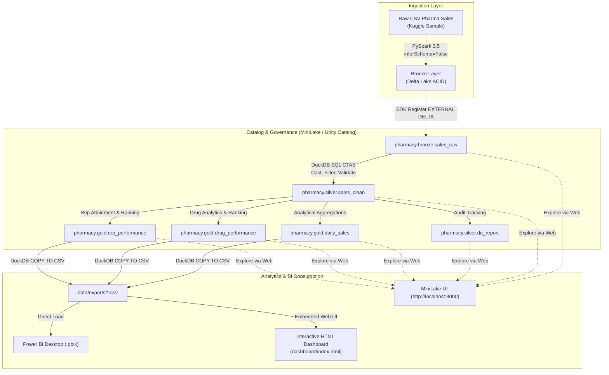

# Pharma Lakehouse Medallion Pipeline

[](https://github.com/livejpsingh/pharma-lakehouse-medallion/actions/workflows/ci.yml)
[](https://github.com/livejpsingh/pharma-lakehouse-medallion/actions/workflows/cd.yml)
[](https://www.python.org/downloads/release/python-3110/)
[](https://delta.io/)
[](https://duckdb.org/)
[](https://github.com/lake-data/minilake)
[](https://opensource.org/licenses/MIT)

An enterprise-grade, reproducible Data Lakehouse pipeline demonstrating the **Medallion Architecture (Bronze &rarr; Silver &rarr; Gold)** locally without cloud infrastructure costs. It emulates Databricks Workspace and Unity Catalog APIs via **MiniLake**, processes data using a hybrid **PySpark 3.5 + DuckDB** dual-engine pattern, guarantees data quality, and outputs analytical datasets to both an **interactive HTML web dashboard** and **Power BI Desktop**.

---

## 1. Architectural Highlights



### Key Engineering Features
- **Dual-Engine Architecture**: PySpark handles Bronze Delta ingestion ensuring full ACID transaction log generation (`_delta_log/`); MiniLake's internal DuckDB engine handles high-throughput Silver cleansing and Gold analytical aggregations via the Databricks Statement Execution API.
- **Unity Catalog Compliance**: Organizes schemas under a 3-level namespace (`pharmacy.bronze`, `pharmacy.silver`, `pharmacy.gold`).
- **Data Quality Framework**: Quarantines records with missing dates or negative revenues into an audit log (`pharmacy.silver.dq_report`) with pass/fail tracking.
- **Production CI/CD**: Fully automated GitHub Actions pipeline with Ruff linting, Pytest test suites, Docker service container integration tests, and GHCR container deployment.
- **Zero Cloud Costs**: 100% locally runnable via Docker Compose or native Python.

---

## 2. Medallion Layers

| Layer | Object Name | Engine / Format | Function & Rules |
|---|---|---|---|
| **Bronze** | `pharmacy.bronze.sales_raw` | PySpark &rarr; Delta Lake | Raw ingestion with schema preservation (`inferSchema=False`). Appends metadata columns `_ingest_timestamp` and `_source_file`. Registered as `EXTERNAL DELTA`. |
| **Silver** | `pharmacy.silver.sales_clean` | DuckDB &rarr; Managed | Cleansed, deduplicated, and type-cast records. Enforces positive revenue (`total_amount > 0`), valid dates, and standardized uppercase status codes. |
| **Silver** | `pharmacy.silver.dq_report` | DuckDB &rarr; Managed | Operational data quality log tracking total bronze records (20), clean silver records (18), dropped records (2), and pass rate (90.0%). |
| **Gold** | `pharmacy.gold.daily_sales` | DuckDB &rarr; CSV Export | Time-series aggregates by transaction date, sales channel, and product category. |
| **Gold** | `pharmacy.gold.drug_performance` | DuckDB &rarr; CSV Export | Drug-level revenue ranking (`DENSE_RANK() OVER (ORDER BY revenue DESC)`), unit volume, and return rates. |
| **Gold** | `pharmacy.gold.rep_performance` | DuckDB &rarr; CSV Export | Sales representative attainment % against target, order counts, and representative performance ranking. |

---

## 3. Project Structure

```
pharma-lakehouse-medallion/
├── .github/
│   └── workflows/
│       ├── ci.yml                 # CI: Ruff, Pytest, MiniLake Integration E2E, Schema Gate
│       └── cd.yml                 # CD: Multi-platform Docker build, GHCR push, GitHub Release
├── dashboard/
│   ├── index.html                 # Interactive multi-tab HTML/Tailwind web dashboard
│   └── pharmacy_sales_analytics.pbix  # Power BI template
├── data/
│   ├── raw/                       # Source CSV (pharma_sales.csv)
│   ├── delta/                     # Delta Lake parquet files and _delta_log
│   └── exports/                   # Exported Gold analytical CSVs
├── docs/                          # Comprehensive technical documentation
│   ├── architecture.md            # System architecture, dual-engine design, catalog layout
│   ├── data_dictionary.md         # Schema definitions for raw, bronze, silver, and gold
│   ├── data_quality_framework.md  # Audit validation rules, quarantine logic, SLA gates
│   ├── deployment_guide.md        # Local, Docker Compose, and Databricks Cloud migration
│   ├── cicd_pipeline.md           # CI/CD specification, gates, and GHCR registry
│   └── bi_reporting_guide.md      # Power BI DAX formulas, web dashboard, MiniLake UI
├── scripts/
│   ├── config.py                  # Databricks SDK client config and folder resolution
│   ├── 01_setup_catalog.py        # Idempotent catalog & schema provisioning
│   ├── 02_bronze_ingest.py        # PySpark raw CSV to Delta Lake ingestion
│   ├── 03_silver_transform.py     # DuckDB SQL cleansing and DQ audit log creation
│   ├── 04_gold_metrics.py         # Gold layer analytical models & CSV exports
│   └── run_all.py                 # Master orchestrator script
├── tests/
│   ├── test_config.py             # Configuration and environment tests
│   ├── test_data_quality.py       # Silver DQ cleansing logic tests
│   └── test_gold_exports.py       # Gold CSV schema and data integrity tests
├── Dockerfile                     # OpenJDK 21 + Python 3.11 production container
├── docker-compose.yml             # Orchestrates MiniLake + Pipeline runner
├── pyproject.toml                 # Ruff and Pytest project configuration
├── requirements.txt               # Pinned Python dependencies
└── README.md
```

---

## 4. Quick Start Guide

### Option A: 1-Click Execution via Docker Compose (Recommended)

Requires [Docker Desktop](https://www.docker.com/products/docker-desktop/).

```powershell
# Clone the repository
git clone https://github.com/livejpsingh/pharma-lakehouse-medallion.git
cd pharma-lakehouse-medallion

# Build and run the entire pipeline end-to-end
docker compose up --build
```

The pipeline completes in ~35 seconds, running:
1. `minilake`: Starts Databricks API emulator on port `8000`.
2. `pipeline`: Runs `scripts/run_all.py` inside an OpenJDK 21 + Python 3.11 environment.

---

### Option B: Local Python Execution

#### 1. Start MiniLake Container
```powershell
docker run -d `
  --name minilake `
  -p 8000:8000 `
  -v "${PWD}/data:/data" `
  -v "${PWD}/exports:/data/exports" `
  ghcr.io/lake-data/minilake:latest
```

Verify health:
```powershell
curl http://localhost:8000/_minilake/health
# {"status":"ok"}
```

#### 2. Install Python Dependencies
```powershell
# Note: Requires Java 17 or 21 on host if running PySpark directly
pip install -r requirements.txt
```

#### 3. Run Pipeline Orchestration
```powershell
python scripts/run_all.py
```

---

## 5. Reporting & Dashboards

### 1. Interactive HTML Web Dashboard
Open `dashboard/index.html` directly in your browser or serve locally:
```powershell
python -m http.server 3000 --directory dashboard
# Navigate to http://localhost:3000
```
- **Executive Metrics**: Total Revenue ($148,630.00), Units Sold (1,714), Orders (18), DQ Pass Rate (90.0%).
- **Views**: Executive Overview, Drug Performance Rankings, Sales Rep Attainment %, and Data Quality Audit.

### 2. Microsoft Power BI Desktop
1. Open Power BI Desktop.
2. Load CSV files from `data/exports/`:
   - `daily_sales.csv`
   - `drug_performance.csv`
   - `rep_performance.csv`
3. Refer to the [BI Reporting Guide](docs/bi_reporting_guide.md) for pre-built DAX formulas and visual templates.

### 3. MiniLake Web Catalog UI
Open `http://localhost:8000` in your browser to explore the Unity Catalog hierarchy (`pharmacy` &rarr; `bronze`, `silver`, `gold`) and execute interactive SQL queries.

---

## 6. Testing & Quality Assurance

Run the test suite locally:

```powershell
# Run Ruff linting and formatting checks
ruff check .
ruff format --check .

# Run Pytest unit and schema validation tests
pytest -v
```

Test results:
```
tests/test_config.py::test_config_endpoints PASSED
tests/test_config.py::test_directory_structure PASSED
tests/test_data_quality.py::test_data_quality_rejection_rules PASSED
tests/test_data_quality.py::test_status_normalization PASSED
tests/test_gold_exports.py::test_gold_exports_exist_and_non_empty PASSED
```

---

## 7. Documentation Index

For deep-dive technical references, consult the `docs/` directory:

| Document | Description |
|---|---|
| [**Architecture & Design**](docs/architecture.md) | Deep dive into PySpark + DuckDB dual-engine pattern, storage layout, and Unity Catalog. |
| [**Data Dictionary**](docs/data_dictionary.md) | Full column descriptions, data types, nullability, and business definitions for all layers. |
| [**Data Quality Framework**](docs/data_quality_framework.md) | Validation rules, quarantine logic, data quality metrics, and SLA enforcement. |
| [**Deployment Guide**](docs/deployment_guide.md) | Local native setup, Docker Compose deployment, and cloud Databricks migration path. |
| [**CI/CD Pipeline**](docs/cicd_pipeline.md) | GitHub Actions workflows, automated testing gates, container registry, and release tagging. |
| [**BI Reporting Guide**](docs/bi_reporting_guide.md) | Power BI Desktop integration, DAX measures, web dashboard walkthrough, and MiniLake UI. |

---

## 8. License

Distributed under the Apache 2.0 / MIT Open Source license. See repository terms for details.
