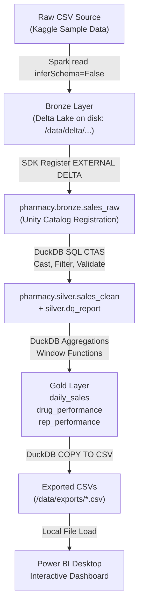

# Architecture & Engineering Design

## Medallion Architecture on MiniLake (Local Databricks API Emulator)

## Architectural Tenets & Rules

### 1. Dual-Engine Model: Spark vs DuckDB
MiniLake implements the Databricks Workspace & Unity Catalog APIs locally. However, its compute engine is **DuckDB**, not Spark SQL.

- **Bronze writes**: Spark writes Delta files to `/data/delta/...` with ACID transactional guarantees.
- **Table Registration**: Tables written by Spark must be registered as `EXTERNAL` with `format=DELTA` pointing to `/data/...`.
- **Managed Table Trap**: MiniLake `MANAGED` tables are internal DuckDB tables. If created as `MANAGED`, Spark cannot see or read them.
- **Transformations & Gold**: Handled directly through the Databricks Statement Execution API executing DuckDB SQL.

### 2. DuckDB Delta Operations Strategy
DuckDB's Delta extension provides fast read and CTAS capability, but limited support for in-place atomic row updates (`UPDATE` / `DELETE`). Consequently, the Silver and Gold transformations follow the idempotent **CTAS (Create Table As Select)** pattern with explicit table recreation.

### 3. Data Quality & Observability
Because MiniLake does not support Databricks Lakehouse Expectations or Delta Live Tables (DLT), the pipeline computes and persists a dedicated data quality tracking table (`pharmacy.silver.dq_report`) logging:
- Ingested Bronze record count
- Validated Silver record count
- Dropped record count (invalid dates, negative units/revenue)
- DQ pass percentage and timestamp
