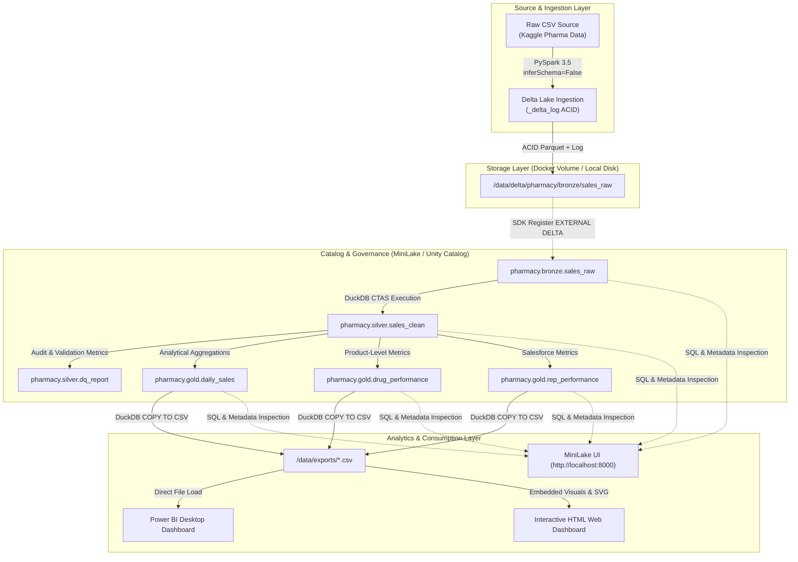

# Architecture & Engineering Design

## 1. System Overview

The **Pharma Lakehouse Medallion Pipeline** is an enterprise-grade data lakehouse implementation tailored for pharmaceutical transaction and performance analytics. It implements the classic **Medallion Architecture** (Bronze &rarr; Silver &rarr; Gold) locally using **MiniLake**, an open-source local emulator for the Databricks Workspace and Unity Catalog APIs.



---

## 2. Dual-Engine Architecture: PySpark + DuckDB

A primary technical innovation of this architecture is the optimal allocation of compute engines across the pipeline stages:

```
+-----------------------------------------------------------------------------+
|                               Pipeline Stages                               |
+------------------------------------+----------------------------------------+
| Bronze Ingestion (Raw -> Delta)    | Silver & Gold (Transform & Aggregations)|
+------------------------------------+----------------------------------------+
| Engine: PySpark 3.5.0 + delta-spark| Engine: MiniLake DuckDB SQL            |
| Protocol: Databricks SDK / Native  | Protocol: Databricks Statement API     |
| Reason: True ACID transactional    | Reason: High speed in-memory SQL, zero |
| write, parquet column serialization| serialization overhead, sub-second CTAS|
+------------------------------------+----------------------------------------+
```

### 2.1 Why PySpark for Bronze?
- **Schema Preservation**: Ingests raw CSV columns with `inferSchema=False` so that strings are preserved without loss of leading zeroes or unexpected datetime coercions.
- **ACID Transaction Log**: Writes Delta files with `_delta_log/00000000000000000000.json` containing table metadata, protocol version, schema, and add file actions.
- **Auditing Columns**: Appends `_ingest_timestamp` and `_source_file` metadata columns.

### 2.2 Why DuckDB for Silver & Gold?
- **Execution Speed**: DuckDB executes vectorized columnar operations in memory with minimal memory footprint compared to starting a JVM Spark cluster for transformations.
- **Native Databricks API Integration**: MiniLake executes queries through `/api/2.0/sql/statements/`, providing an identical interface to cloud Databricks SQL Warehouses.
- **Analytical Window Functions**: Native support for complex SQL functions (`DENSE_RANK()`, `SUM() OVER ()`, `EXTRACT()`).

---

## 3. Storage & Catalog Topology

### 3.1 Unity Catalog 3-Level Namespace
MiniLake provides Unity Catalog compliance using the hierarchical format:
`catalog.schema.table`

```
pharmacy (Catalog)
├── bronze (Schema)
│   └── sales_raw (EXTERNAL DELTA -> /data/delta/pharmacy/bronze/sales_raw)
├── silver (Schema)
│   ├── sales_clean (MANAGED -> DuckDB columnar table)
│   └── dq_report (MANAGED -> Audit and quality log)
└── gold (Schema)
    ├── daily_sales (MANAGED -> Date, channel, category aggregates)
    ├── drug_performance (MANAGED -> Drug-level revenue and ranking)
    └── rep_performance (MANAGED -> Sales rep revenue and rankings)
```

### 3.2 External Delta vs Managed Tables
- **`EXTERNAL DELTA`**: Used for `pharmacy.bronze.sales_raw`. Points directly to the file system path where PySpark writes the Delta Lake files. This allows DuckDB inside MiniLake to read Delta transaction logs and Parquet data directly.
- **`MANAGED`**: Used for Silver and Gold tables. Managed directly inside MiniLake's persistent catalog (`data/catalog.duckdb`), optimizing read performance for SQL statements and exports.

---

## 4. Medallion Layer Specifications

| Layer | Object Name | Storage Format | Type | Primary Function |
|---|---|---|---|---|
| **Bronze** | `pharmacy.bronze.sales_raw` | Delta Lake / Parquet | External | Append-only raw ingested CSV data with metadata tracking columns. |
| **Silver** | `pharmacy.silver.sales_clean` | DuckDB Columnar | Managed | Cleaned, deduplicated, type-cast records with positive revenue constraints. |
| **Silver** | `pharmacy.silver.dq_report` | DuckDB Columnar | Managed | Operational audit log recording ingestion volumes, pass rates, and dropped rows. |
| **Gold** | `pharmacy.gold.daily_sales` | DuckDB Columnar / CSV | Managed | Daily time-series aggregates partitioned by transaction date, channel, and category. |
| **Gold** | `pharmacy.gold.drug_performance`| DuckDB Columnar / CSV | Managed | Product-level sales, total units, return rates, and revenue rank. |
| **Gold** | `pharmacy.gold.rep_performance` | DuckDB Columnar / CSV | Managed | Sales representative revenue, target attainment %, units sold, and rep ranking. |

---

## 5. Security & Isolation

- **Isolated Execution**: All pipeline tasks run in Docker containers with least-privilege configurations.
- **Zero Hardcoded Secrets**: Databricks client uses token-based authentication configured via `DATABRICKS_HOST` and `DATABRICKS_TOKEN`.
- **Reproducible Container Base**: OpenJDK 21 + Python 3.11 Debian slim base avoids Java 25 compatibility traps while ensuring deterministic build outputs.
