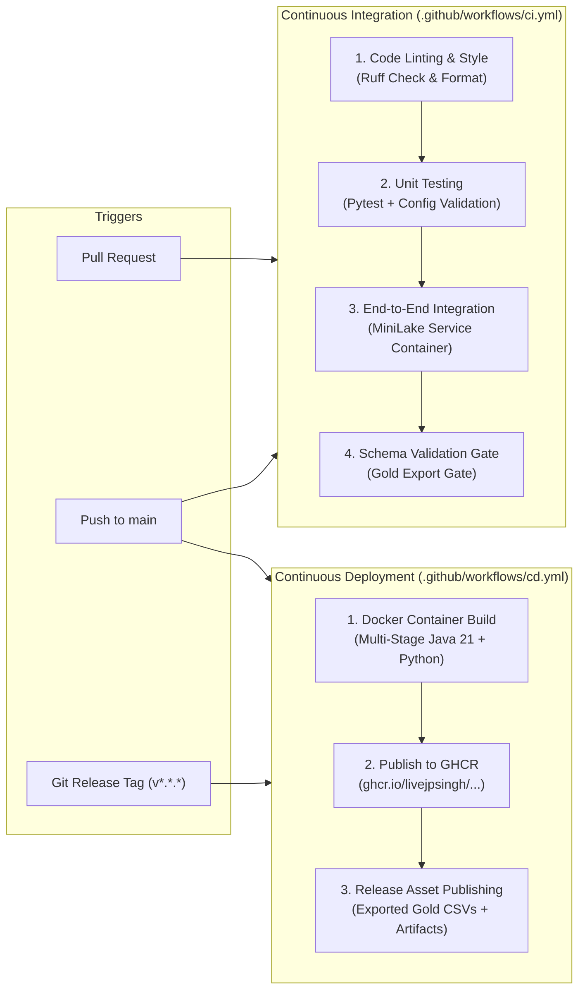

# CI/CD Pipeline & DevOps Specification

This document details the Continuous Integration (CI) and Continuous Deployment (CD) architecture for the **Pharma Lakehouse Medallion Pipeline**.

---

## 1. CI/CD Architecture Overview



---

## 2. Continuous Integration (`ci.yml`)

The CI workflow is triggered on every **Push to `main`** and **Pull Request targeting `main`**. It runs on `ubuntu-latest` and executes four strict quality gates:

### Gate 1: Code Linting & Static Analysis
- **Tool**: [Ruff](https://astral.sh/ruff)
- **Checks**:
  - `ruff check .` &mdash; Validates PEP 8 compliance, checks for unused imports, undefined variables, and deprecated syntax.
  - `ruff format --check .` &mdash; Enforces uniform code formatting without modifying files.

### Gate 2: Unit & Configuration Testing
- **Tool**: `pytest`
- **Test Matrix**:
  - `tests/test_config.py`: Validates environment settings, Databricks endpoint URLs, schema names, and folder directory resolution.
  - `tests/test_data_quality.py`: Tests the Silver DQ filtering logic (null date drops, negative price rejection, status normalization).
  - `tests/test_gold_exports.py`: Validates schema integrity, column names, and data types across Gold analytical CSVs.

### Gate 3: End-to-End Pipeline Execution (Integration Test)
- **Service Container**: Spins up `ghcr.io/lake-data/minilake:latest` alongside the runner on port `8000`.
- **Runtime Environment**:
  - OpenJDK 21 (for PySpark Delta Lake runtime)
  - Python 3.11
- **Execution**: Runs `python scripts/run_all.py` against the live MiniLake service container.
- **Verification**: Asserts that all 4 scripts complete with returncode `0` and generates:
  - Bronze Delta logs in `data/delta/`
  - Silver & Gold tables in MiniLake
  - Export CSVs in `data/exports/`

### Gate 4: Gold Export Schema Gate
- Confirms that the following artifacts are produced and non-empty:
  - `data/exports/daily_sales.csv`
  - `data/exports/drug_performance.csv`
  - `data/exports/rep_performance.csv`
- Uploads the exported datasets as GitHub Actions run artifacts for 7-day retention.

---

## 3. Continuous Deployment (`cd.yml`)

The CD workflow triggers upon pushes to `main` or semantic release tags (`v*.*.*`).

### 3.1 Container Packaging & GHCR Registry
- Authenticates using `GITHUB_TOKEN`.
- Builds the production image defined in `Dockerfile`:
  - Base: `debian:trixie-slim`
  - JRE: OpenJDK 21 headless
  - Python: 3.11 with `pip install -r requirements.txt`
- Tags the image:
  - `ghcr.io/livejpsingh/pharma-lakehouse-medallion:latest`
  - `ghcr.io/livejpsingh/pharma-lakehouse-medallion:sha-<commit>`
  - `ghcr.io/livejpsingh/pharma-lakehouse-medallion:<tag>` (when triggered by tag)

### 3.2 Automated GitHub Releases
- When triggered by a semantic release tag (e.g. `v1.0.0`):
  - Generates automated release notes from merged commits and PRs.
  - Archives the Gold exported data (`gold_exports.zip`).
  - Publishes the release on GitHub with downloadable analytical CSV packages.

---

## 4. Local Developer CI Workflow

Developers can run the full CI suite locally before submitting PRs:

```powershell
# 1. Run Ruff Linter and Formatter
ruff check .
ruff format --check .

# 2. Run Pytest Suite
pytest -v

# 3. Test Full Pipeline via Docker Compose
docker compose up --build --abort-on-container-exit
```
