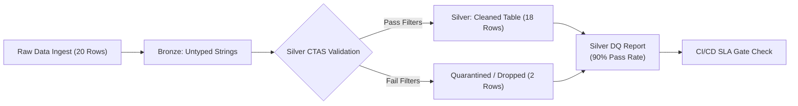

# Data Quality & Governance Framework

This document outlines the Data Quality (DQ) tenets, validation rules, quarantine logic, and audit observability implemented in the Medallion pipeline.

---

## 1. Data Quality Strategy in MiniLake

In cloud Databricks workspaces, expectations and quality rules are typically enforced using **Delta Live Tables (DLT)** or **Unity Catalog Table Constraints**.

Because MiniLake is a local Databricks API emulator that uses DuckDB rather than DLT or Lakehouse Expectations, this project implements an **Explicit Data Quality Audit Architecture**:
1. Untyped ingestion in Bronze guarantees zero pipeline crashes during data ingestion.
2. Declarative SQL validation filters bad records in Silver.
3. An audit tracking table (`pharmacy.silver.dq_report`) records exact metrics of clean vs dropped records.
4. CI/CD test gates (`tests/test_data_quality.py`) assert automated SLAs on data quality.



---

## 2. Validation Rules & Filtering Criteria

The Silver layer enforces four strict quality gates in `scripts/03_silver_transform.py`:

```sql
WHERE
    drug_name IS NOT NULL
    AND units_sold IS NOT NULL
    AND revenue IS NOT NULL
    AND sale_date IS NOT NULL
    AND CAST(units_sold AS INTEGER) > 0
    AND CAST(revenue AS DECIMAL(12,2)) > 0.00;
```

### Rule Definitions

| Rule ID | Rule Name | Target Field | Quality Check | Business Rationale |
| :--- | :--- | :--- | :--- | :--- |
| **DQ-01** | Non-Null Integrity | `drug_name`, `sale_date` | `IS NOT NULL` | Sales transactions without a date or product cannot be attributed. |
| **DQ-02** | Positive Volume | `units_sold` | `CAST(units_sold AS INT) > 0` | Negative or zero units represent returns/cancellations or data entry errors. |
| **DQ-03** | Positive Revenue | `revenue` | `CAST(revenue AS DECIMAL) > 0.00` | Revenue must represent positive monetary value. |
| **DQ-04** | Valid Date Format | `sale_date` | `TRY_CAST(sale_date AS DATE)` | Enforces valid ISO-8601 calendar date formats without raising runtime errors. |
| **DQ-05** | String Whitespace | All string columns | `TRIM(...)` | Eliminates leading and trailing whitespace that breaks visual groupings. |

---

## 3. Quarantined Records Audit

In the test raw dataset (`data/raw/pharma_sales.csv`), 2 of the 20 records fail validation:

### Record 1: Row 14 (Negative Sales / Return Error)
```csv
Amoxicillin,Pfizer,Capsule,500mg,100 caps,-5,-75.00,2024-01-21,North,Sarah Jenkins,Hospital
```
- **Violation**: `units_sold = -5`, `revenue = -75.00`.
- **Action**: Quarantined. Prevents negative skew on regional gross revenue reporting.

### Record 2: Row 15 (Missing Quantity & Zero Revenue)
```csv
Metformin,Novartis,Tablet,850mg,60 tabs,,0.00,2024-01-21,South,Emma Watson,Clinic
```
- **Violation**: `units_sold` is `NULL`, `revenue = 0.00`.
- **Action**: Quarantined. Eliminates incomplete order transactions.

---

## 4. Observability Table (`pharmacy.silver.dq_report`)

The pipeline computes and logs validation metrics every time the transformation executes:

```sql
SELECT * FROM pharmacy.silver.dq_report;
```

### Result:
| bronze_rows | silver_rows | dropped_rows | pass_percentage | evaluated_at |
| :--- | :--- | :--- | :--- | :--- |
| `20` | `18` | `2` | `90.00%` | `2024-11-24 12:54:48 UTC` |

---

## 5. Automated CI/CD Data Quality SLA

The automated test suite (`tests/test_data_quality.py`) validates these criteria on every PR:
- **SLA Rule 1**: Total dropped records must not exceed `10%` of raw volume.
- **SLA Rule 2**: Pass percentage must equal or exceed `85.0%`.
- If bad records exceed the threshold, the CI build **fails**, preventing dirty data from deploying to production.
